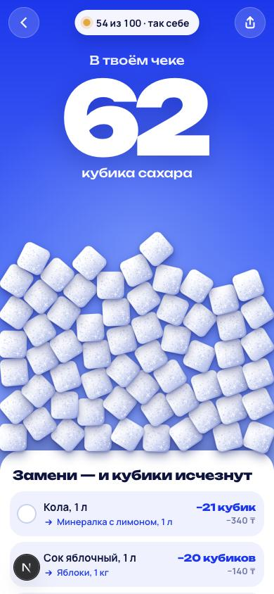

# Чек-ап

**Сфоткай магазинный чек, чтобы увидеть примерный состав покупок и сколько они стоят.** «Чек-ап» показывает добавленный сахар, соль, насыщенные жиры, калории, углеводы и белки. Ещё он предлагает замены и сравнивает цены между магазинами.



## Что внутри

Мобильное приложение и сайт — два клиента одного **сервера и одной базы данных**:

```
 Flutter-приложение (mobile/) ─┐
                               ├──►  Next.js (web/): сайт + /api/*  ──►  Postgres (PGlite локально, Supabase/Neon в продакшене)
 Веб-версия (web/) ────────────┘                  │
                                                  └──►  ИИ-распознавание чеков (OpenRouter · GLM 5.3 Flash)
```

| Папка | Что это |
|---|---|
| [`web`](web) | Next.js: сайт **и** сервер (API, БД, распознавание чеков) |
| [`mobile`](mobile) | приложение на Flutter (iOS, Android, веб-сборка) |
| [`design`](design) | дизайн-варианты и 3D-модели кубиков |
| [`docs`](docs) | исследование: какой моделью распознавать чеки, цены |
| [`prototype`](prototype) | первый прототип на Vite (для истории) |

## Возможности

- **Скан чека** — позиции и оценки всех шести показателей, оценка корзины 0–100. Только сахар показан кубиками по 5 г. Все показатели используют одну физическую сцену: соль собирается в россыпь кристаллов, жиры — в ломтики сливочного масла по 2 г, калории — в тлеющие угольки по 200 ккал, углеводы — в батоны по 10 г, белок — в яйца по 6 г. Тап подбрасывает предметы, а наклон пересыпает их на поддерживаемых устройствах.
- **Замены** — включаешь замену, и кубики исчезают; считаются экономия и оценка. Замены уходят в **список на следующий поход**.
- **Деньги** — **цена вреда** для сахара, соли и насыщенных жиров, а для калорий, углеводов и белков — нейтральная сводка стоимости, траты на вредное, строка **«Алкоголь и энергетики»** и **«Где дешевле»**: те же покупки в других магазинах по чекам пользователей.
- **Штрихкод до кассы** (приложение) — наводишь камеру на товар у полки и видишь показатели с этикетки, если они есть в базе. База — Open Food Facts.
- **Неделя** — сводка за 7 дней по каждому показателю, норма семьи, источники, деньги, прогноз «если так весь год» (в приложении).
- **Продукты** — справочник «что внутри» с поиском и выбором показателя; **достижения**; «Это как…» (банки колы, чайные ложки соли, пачки масла).
- **Один аккаунт на всех устройствах** — чеки и профиль синхронизируются между приложением и сайтом по короткому коду.

## Быстрый старт

Нужны Node 22 + pnpm и Flutter 3.44. Docker не нужен.

```bash
# 1. сервер и сайт: http://localhost:3000
cd web && pnpm install && pnpm dev

# 2. приложение, тот же сервер (адрес компьютера в твоей Wi-Fi сети)
cd mobile && flutter pub get && flutter run --dart-define=API_URL=http://192.168.1.10:3000
```

Без ключей всё работает: БД встроенная, чеки показываются в демо-режиме. Чтобы читать настоящие чеки, впиши ключ в `web/.env.local` (шаблон — `web/.env.local.example`). Подробности — в [web/README.md](web/README.md) и [mobile/README.md](mobile/README.md).

## Как устроена синхронизация

Аккаунт анонимный: первый запуск создаёт пользователя и токен устройства (в БД лежит только его хеш). Чтобы открыть те же данные на другом устройстве, на первом нажимаешь «Код для другого устройства», на втором — «У меня есть код». Дальше каждое устройство шлёт на `/api/sync` свои чеки, профиль и список, а сервер сливает их по принципу «последний записал — прав» и возвращает итог. Удаления передаются «надгробиями», счётчики достижений только растут. Слияние — чистые функции с тестами (`web/src/server/merge.ts`), интеграционный тест идёт на настоящем Postgres.

## Сравнение цен

Из каждого отсканированного чека сервер выделяет «категория товара + цена за кг/л + магазин + дата» и хранит это без привязки к людям (демо-чеки не учитываются, выдуманных цен нет). Когда ты открываешь чек, сервер берёт медианные цены других магазинов за 90 дней и показывает, где дешевле, если разница больше 8% и больше 30 ₸. Данных пока мало — они появляются по мере сканирования чеков.

## Приватность

Фото чека уходит на сервер, распознаётся и **не сохраняется**: в БД попадают только позиции, суммы и оценки сахара. Токен устройства хранится в БД хешем. Цены для сравнения магазинов хранятся отдельно и анонимно (категория, цена за кг/л, магазин, дата): по ним нельзя узнать ни человека, ни название купленного товара. Ключи ИИ живут только на сервере.

## Известные ограничения

- Распознавание занимает 15–25 секунд. Показатели для известных категорий берутся из справочника (стабильно), для неизвестных товаров оценивает модель, и такие цифры могут «плавать» между запусками. Чеки из фото помечены «приблизительно».
- «Где дешевле» работает только по реальным отсканированным чекам других пользователей, поэтому на старте почти пусто. Сравниваются позиции, у которых в названии есть объём или вес.
- Калории в оценку корзины не входят: еда должна быть калорийной, важно, откуда они. Нормы по калориям — грубый ориентир (2000 ккал взрослому, 1500 ребёнку), он не учитывает возраст, пол и активность.
- Аккаунт анонимный: если потерять все устройства, доступ не восстановить. Входа по почте или телефону пока нет.
- Лимиты запросов хранятся в памяти одного экземпляра сервера — для нескольких экземпляров нужен общий счётчик.
- Список покупок и проверка по штрихкоду пока есть только в приложении; на сайте их нет.
- Оценки примерные и не заменяют консультацию врача.
